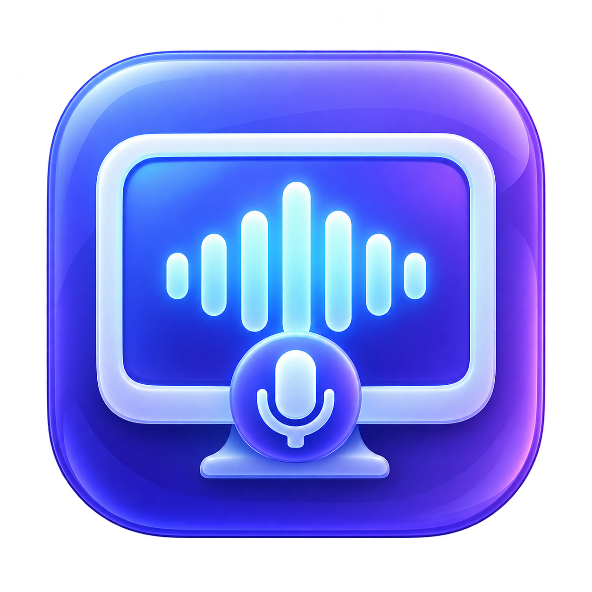

# ScreenSound



A native macOS app for recording system audio and microphone audio together,
with optional screen recording and opt-in OpenAI transcription and text analysis.

**Requirements:** Apple Silicon, macOS 15 or later. The interface is in English.
No virtual audio driver or third-party runtime is required.

## What it does

- Records system audio, a selected microphone, or both; exports one mixed audio track.
- Saves audio as M4A (AAC, 48 kHz stereo), or screen and audio as MP4 (H.264).
- Captures a selected display at up to 1920 pixels wide, targeting 30 fps.
- Saves completed recordings locally when you stop, without opening a blocking save dialog.
- Exports a copy to Downloads and restores the latest completed recording at launch.
- Transcribes an existing recording and runs a custom task on the transcript.
- Includes meeting summary, action item, and quarterly goal prompt templates.
- Stores the API key in macOS Keychain; uploads only after an explicit user action.

## Build and launch

Install Apple's Command Line Tools with an SDK supporting macOS 15+ and Swift 6+,
or use Xcode 16 or newer. The compiler uses Swift 5 language mode.

```bash
./build.sh
open build/ScreenSound.app
```

The script builds an arm64 app with a minimum deployment target of macOS 15.0,
adds the icon and usage descriptions, signs it ad hoc, and verifies its signature.
It does not install the app, change privacy permissions, or launch capture.

To choose another build output location, pass an absolute path:

```bash
./build.sh /absolute/path/ScreenSound.app
```

For Xcode, open `ScreenSound.xcodeproj` and select the ScreenSound scheme and My Mac.
Full Xcode is optional for the command-line build. This repository's initial import
was compiled with Command Line Tools; an Xcode-driven build was not verified.

For everyday use, copy the built app to Applications after quitting the previous
copy. Keep one installed copy. Ad-hoc signatures change on rebuild and may require
refreshing macOS permissions. Distribution to other Macs requires appropriate
Developer ID signing and notarization; the build is not notarized.

## First recording

1. Open **Recording**, choose Audio only or Screen + audio, and select sources.
2. Click **Start recording** and grant the requested macOS permissions.
3. Click **Stop recording**. Wait for **Recording saved locally**.
4. Use **Export to Downloads** for a copy, or **Show in Finder** for the saved file.

The app also offers a menu bar stop action. Closing its window leaves the app
running. Use the app's Quit action to exit when recording/AI processing has finished.

See [the user guide](docs/USER_GUIDE.md) for storage, permissions, AI setup, and recovery.

## Tests

```bash
./test.sh
./test-ai.sh
```

Both tests use generated media, temporary directories, and the system media
frameworks. They do not capture the live screen or microphone, read a real API key,
or make paid API requests. API tests use a local URLProtocol mock.

The [development guide](docs/DEVELOPMENT.md) explains coverage and manual checks.

## Documentation

- [User guide and troubleshooting](docs/USER_GUIDE.md)
- [Architecture and data flow](docs/ARCHITECTURE.md)
- [Development, validation, signing and installation](docs/DEVELOPMENT.md)
- [Privacy and local data](docs/PRIVACY.md)
- [Release notes](CHANGELOG.md)
- [AI agent instructions](AGENTS.md)

## Current limitations

Speaker diarization, individual window/application selection, echo cancellation,
and cross-launch transcription resume are not implemented. The app supports
recordings up to 12 hours for AI preparation and caps a single analysis at 400 KB
of UTF-8 transcript text. Model access depends on the user's OpenAI project.
Real API transcription quality has not been validated with a supplied key.

This repository contains the complete buildable project and icon sources.
Generated builds, personal recordings, transcripts, and credentials are local data.
